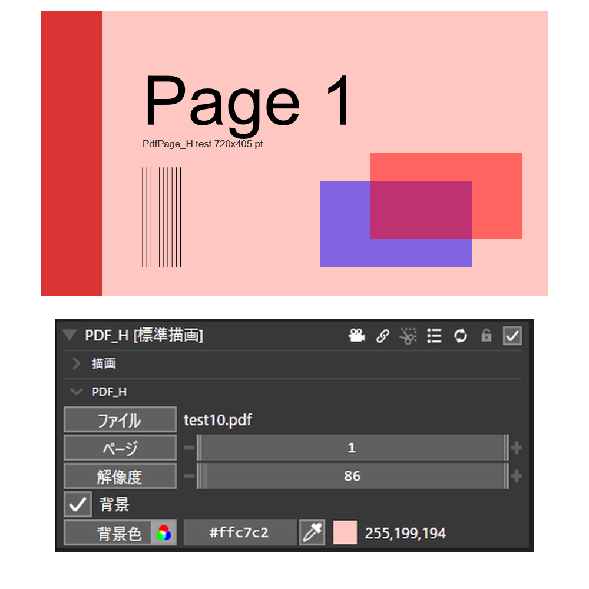

# PdfPage_H マニュアル



**PdfPage_H** は、PDF のページを画像のオブジェクトとして出すプラグイン（Rust 製 `.aux2`）です。
カスタムオブジェクト **PDF_H** を追加します。発表資料（PDF に書き出したスライド）・論文・図面を、そのまま動画に載せられます。
ページの値に中間点を入れれば、スライドを送れます。

- **バージョン:** 0.1.0（2026-10-11）
- **作者:** by HexBrowns
- **必要環境:** AviUtl2 **2.1.13** 以上、Windows 10 / 11

PDF は Windows に入っている PDF の描画機能（`Windows.Data.Pdf`）で描きます。ほかのソフトや DLL は要りません。

---

## 導入

1. `Plugin\PdfPage_H\PdfPage_H.aux2` を配置する（au2pkg なら AviUtl2 の画面へドラッグ＆ドロップ）
2. AviUtl2 を再起動する

### ビルド（開発者向け）

```bash
python AI/tools/au2_build.py PdfPage_H
```

---

## 使い方

### ドロップで置く

`.pdf` をエクスプローラーからタイムラインへドロップすると、落とした位置に **PDF_H** が置かれます（1 ページ目）。
置いた直後なら Ctrl+Z 1 回で取り消せます。

### メニューから置く

タイムラインの空いている所を右クリック → **メディアオブジェクトを追加** の中の **PDF_H** を選び、**ファイル** で PDF を選びます。
メニューの中の並びは、ウィンドウメニューの **設定** → **オブジェクト追加メニューの設定** で変えられます。

### スライドを送る

**ページ** に中間点を入れ、区間ごとに値を変えます。移動方法は **瞬間移動**（移動なしで区間の値を切り替える）にすると、
ページが区間の境目でぱっと切り替わります。直線移動にすると、途中のページを順に通ります。

---

## 設定項目

| 項目 | 範囲 | 初期値 | 説明 |
|---|---|---|---|
| **ファイル** | `.pdf` | 空 | 描く PDF |
| **ページ** | 1〜9999 | 1 | 描くページ。小数は四捨五入。ページ数を超えたら最後のページ |
| **解像度** | 72〜600 | 192 | DPI。16:9 のスライド（PowerPoint の既定の大きさ）を 192 で描くと 1920×1080。A4 縦は 1587×2245 |
| **背景** | ON / OFF | ON | ON で背景色の紙の上に描く。OFF で紙も透明になり、文字や図だけが残る |
| **背景色** | 色 | 白 | 背景が ON のときの紙の色 |

- オブジェクトの大きさは ページの大きさ × 解像度 で決まります。画面に合わせて小さくするより、解像度を下げるほうが軽くなります
- 長辺は 16384 ピクセル、全体は約 6700 万ピクセル（8192×8192）までです。それを超える大判のページは、縦横比を保って縮めて描きます

---

## 重さ

- 描くのはページが変わったフレームだけです。同じページが続く間は、描いた画像を使い回します（1080p で 1 フレーム約 8ms）
- ページを描くのは、FHD のスライドで 1 ページ 20〜35ms、日本語と画像の多い A4 の資料で 1 ページ 100〜180ms ほどです
- **次のページは裏で先に描いておきます。** スライドのように数秒ごとにページを送るなら、ページが変わったフレームも重くなりません。
  ページを飛ばしたとき、毎フレームのようにページを変えたときは、そのフレームで描くので重くなります
- 最初に PDF を開くフレームは、開く分だけ重くなります（0.1〜0.4 秒）

---

## 注意

- **ファイルが無い・PDF でない・壊れている・パスワードが付いている** ときは、何も描きません（透明）。
  理由はログ（`Log\aviutl2_*.log`）に `PDF_H:` で始まる警告として 1 回だけ出ます
- PDF を書き換えて保存し直すと、次に描くときに読み直します
- フォントを埋め込んでいない PDF は、手元のフォントで代わりに描くので、作ったときと見た目が変わることがあります
- 拡大して使うときは、拡大率より解像度を上げてください（拡大率で大きくするとにじみます）
- 描けるのは静止したページの見た目だけです。PDF の中のリンク・動画・フォームの入力は動きません

---

## 英語の表示

`Language\English.pdf_page_h.aul2` を同梱しています。AviUtl2 の言語を English にすると、設定項目が英語で出ます。
